# Revisión UX de GitHub Pages

**Veredicto: herramienta potente, experiencia pesada.** La página permite auditar el sistema, pero exige demasiado esfuerzo para encontrar el guion, entender qué ocurrió y decidir qué hacer. La interfaz había crecido al ritmo de los contratos técnicos; faltaba una jerarquía de trabajo editorial.

Fuente: [Pages](https://jcval94.github.io/AI-News-Daily/), snapshot `c1b139778da7`, publicado por [Review Hub #373](https://github.com/jcval94/AI-News-Daily/actions/runs/39073953118). Capturas de esta auditoría a 1363 × 936. Episodio principal: 2026-09-25; último intento visible: 2026-10-16. No se confunde aprobación con ejecución técnica exitosa.

## Crítica por pestaña

| Paso / pantalla | Crítica exigente | Mejora implementada |
|---|---|---|
| 1. Catálogo / portada | Abrir septiembre con intentos de octubre visibles parece un fallo de actualización. Las cuatro tarjetas laterales consumen demasiado alto. | Contexto explícito de aprobado/intento, accesos al último intento y último aprobado; navegación lateral compacta. En móvil, sección y episodio tienen selectores separados. |
| 2. Resumen | El título y el buscador dominan la pantalla; la decisión editorial llega demasiado tarde. | Encabezado más breve, pestañas en español y contexto de tarea. Se mantienen estado, scores y siguiente acción. |
| 3. Guion | El mapa, siete tarjetas y el bloque de TTS ausente desplazan el texto. Parte del mapa usa letras de 8–10 px. | Lectura enfocada, tarjetas desplegables, audio ausente plegado y tipografía mayor. Se conserva edición local, historial y descarga. |
| 4. Evidencia → Arquitectura | Buenos contenidos, pero la jerarquía compite con el encabezado repetido. | Más espacio útil; subpestañas con roles, nombres y relaciones accesibles. |
| 5. Evidencia → Beats | Los identificadores internos obligan a interpretar la estructura. La navegación no explicaba su función. | Contexto de evidencia y controles legibles. Nombres narrativos legibles; los identificadores originales siguen disponibles para trazabilidad. |
| 6. Evidencia → Fuentes | La tabla permite verificar, pero en pantallas pequeñas necesita un contenedor navegable. | Regiones de tabla enfocables y tarjetas móviles existentes conservadas. |
| 7. Medios | Dos bloques explicativos y múltiples filtros antes de la primera miniatura. Demasiada preparación para una tarea visual. | Proveedor, origen y tipo visibles; licencia, relación documental y explicaciones bajo desplegables. Restablecer permanece visible; procedencia y licencias permanecen intactas. |
| 8. Proceso | El recorrido observado y un manual de arquitectura de 36 etapas forman una página interminable. | Recorrido real primero, arquitectura completa desplegable; secuencia observada en cuadrícula adaptable y etapas no ejecutadas agrupadas. |
| 9. Costos | Las políticas de seis servicios retrasan la comparación de los pasos que consumen dinero. | Políticas de servicios desplegables; costo conocido y gráfico por paso accesibles antes. Sin recalcular ni completar cifras faltantes. |
| 10. Diagnóstico → Jueces | Se entra para diagnosticar y se encuentra otro acordeón cerrado. | Evaluación principal abierta; historial y artefactos mantienen navegación independiente. |
| 11. Diagnóstico → Historial / Artefactos | Tablas útiles pero densas y con poco apoyo para teclado. | Controles mayores, foco visible y regiones desplazables accesibles. |
| 12. Salud | Un estado crítico abre con tarjetas verdes; la incidencia de producción queda debajo del primer pantallazo. | Críticas primero, filtros de severidad de un clic, conteo y recuperación de búsquedas vacías. |
| 13. Memoria → Historias | Casi toda la primera pantalla explica qué es la biblioteca. Los filtros son demasiado pequeños. | Inventario y explicación plegados, pestañas persistentes, filtros táctiles y tarjetas legibles. |
| 14. Memoria → Noticias | Dieciocho categorías compiten con la lectura; el encabezado vuelve a ocupar demasiado. | Categorías frecuentes a mano y categorías adicionales desplegables; se conserva orden por depósito. |
| 15. Memoria → Cobertura y uso | Una lista de 233 mecanismos domina el recorrido y pierde la relación con el uso real. | Lista acotada con desplazamiento y foco de teclado; uso real visible al lado. |
| 16. Métricas | La tabla de 19 columnas exige explorar horizontalmente incluso para comparar lo esencial. | Ocho columnas editoriales iniciales; producción bajo botón explícito. Conteo, estado vacío y tabla enfocables. |
| 17. Experimentos | Mucho espacio entre resultados; regresar de una búsqueda requiere deshacer varios campos. | Tarjetas más compactas y restablecimiento de filtros de un clic. |

## Decisiones

- Conservar la paleta y la arquitectura de vistas existentes. Mejorar jerarquía, lectura y navegación antes de agregar decoración.
- Mantener el aprobado canónico como portada. Mostrar claramente la fecha y el intento reciente; nunca convertir un rechazado en aprobado por razones visuales.
- Aplicar la mejora también al HTML histórico recuperado. Los artefactos antiguos no deben conservar una interfaz obsoleta indefinidamente.
- Respetar movimiento reducido, foco visible y controles de al menos 44 px de alto. Las tablas largas conservan desplazamiento horizontal deliberado.
- Conservar guiones, evidencia, costos y estados originales. La capa UX no altera selección editorial, contratos, gates ni promoción.

## Evidencia visual anterior

Ver las capturas por recorrido

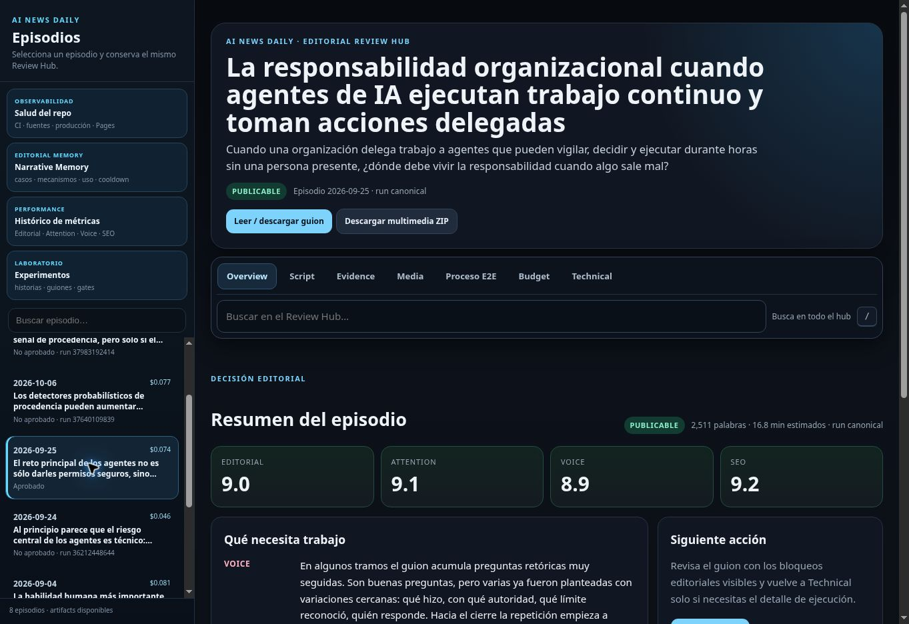
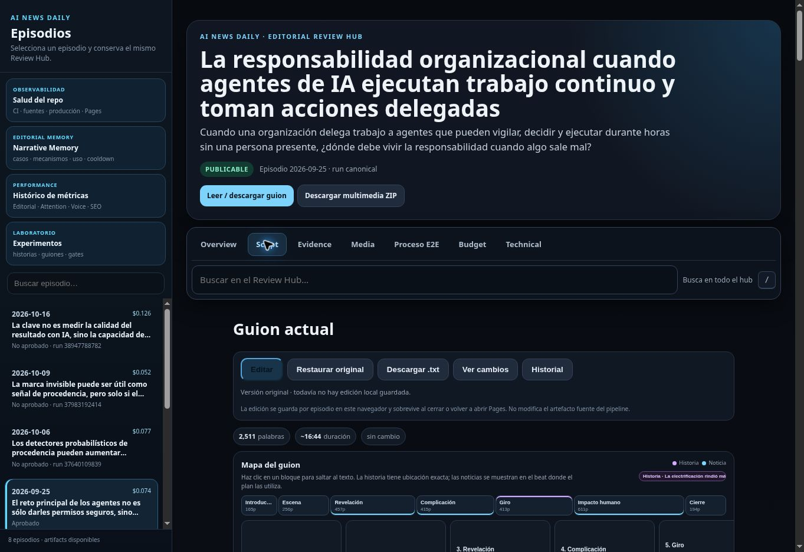
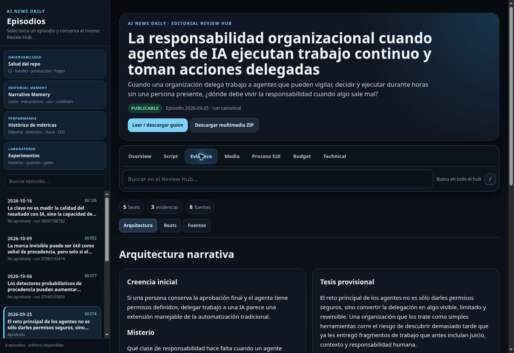
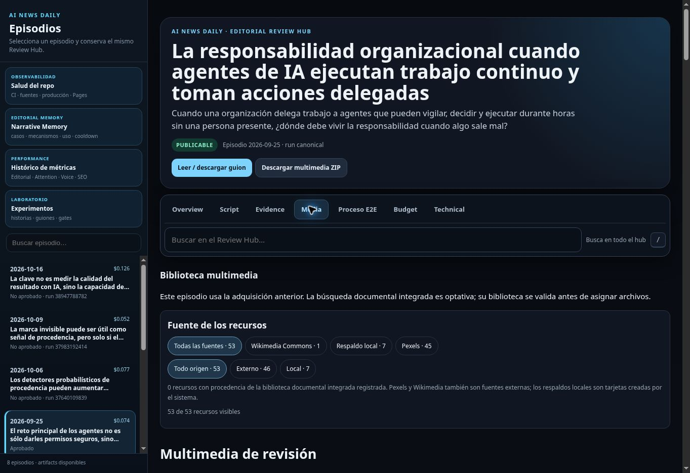

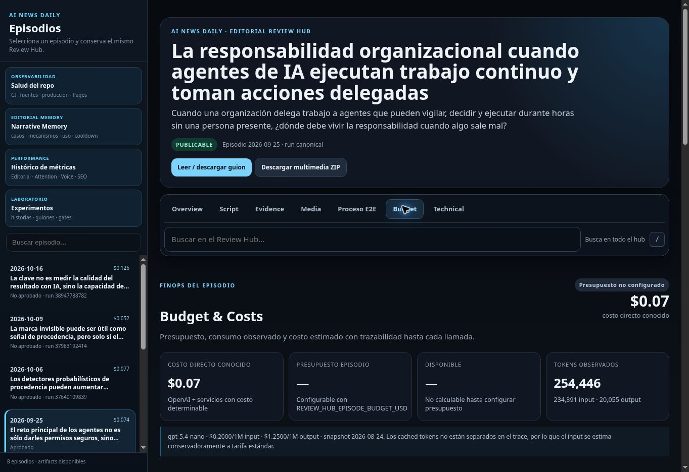
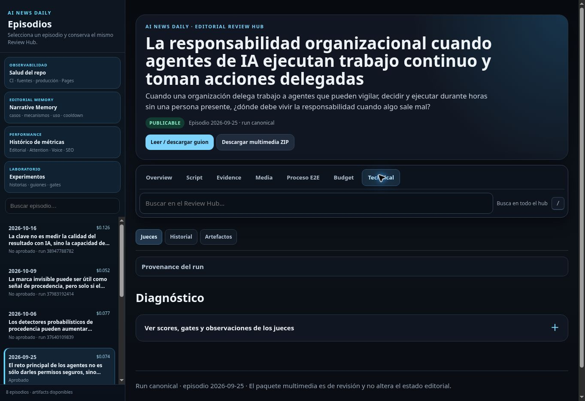
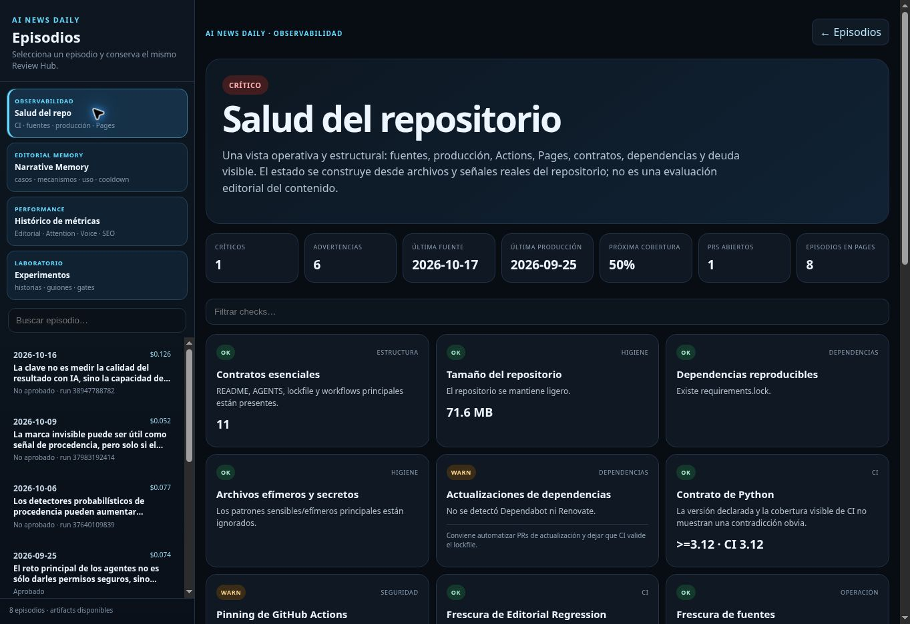
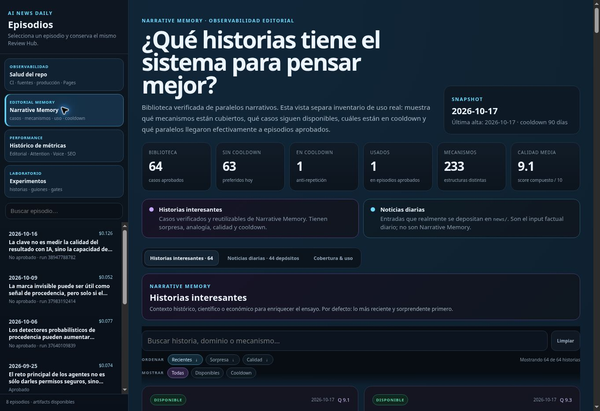
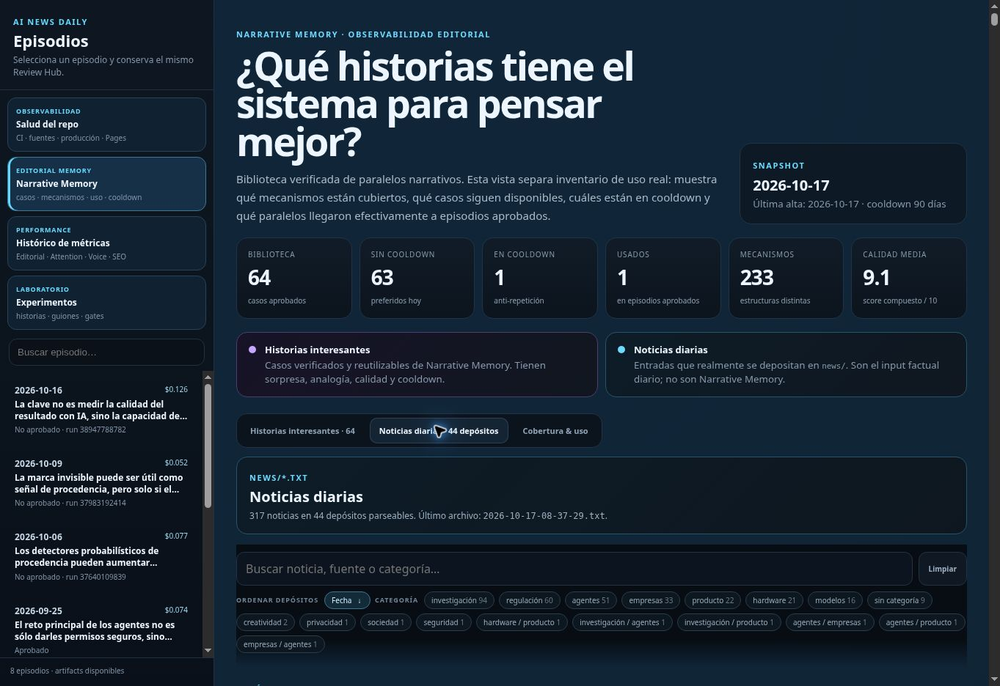
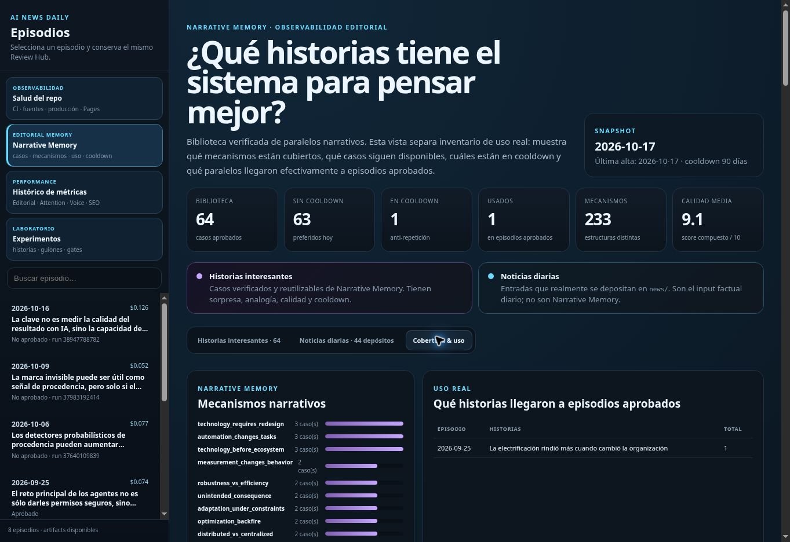
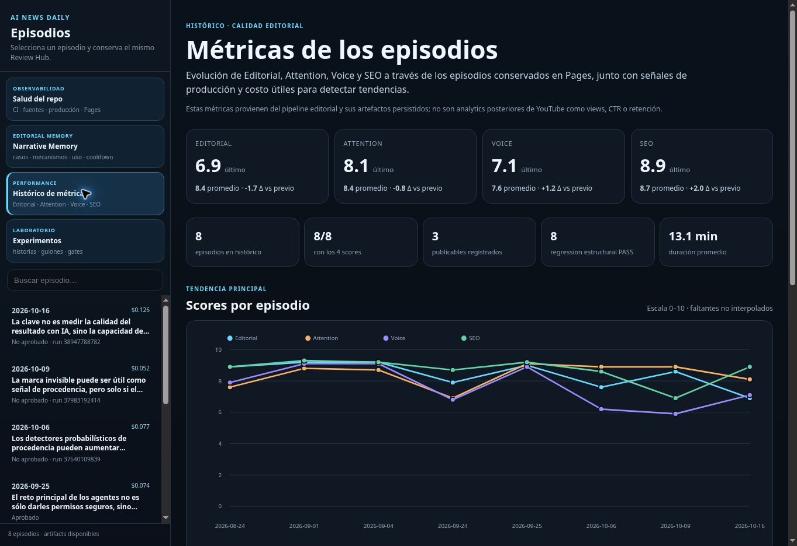
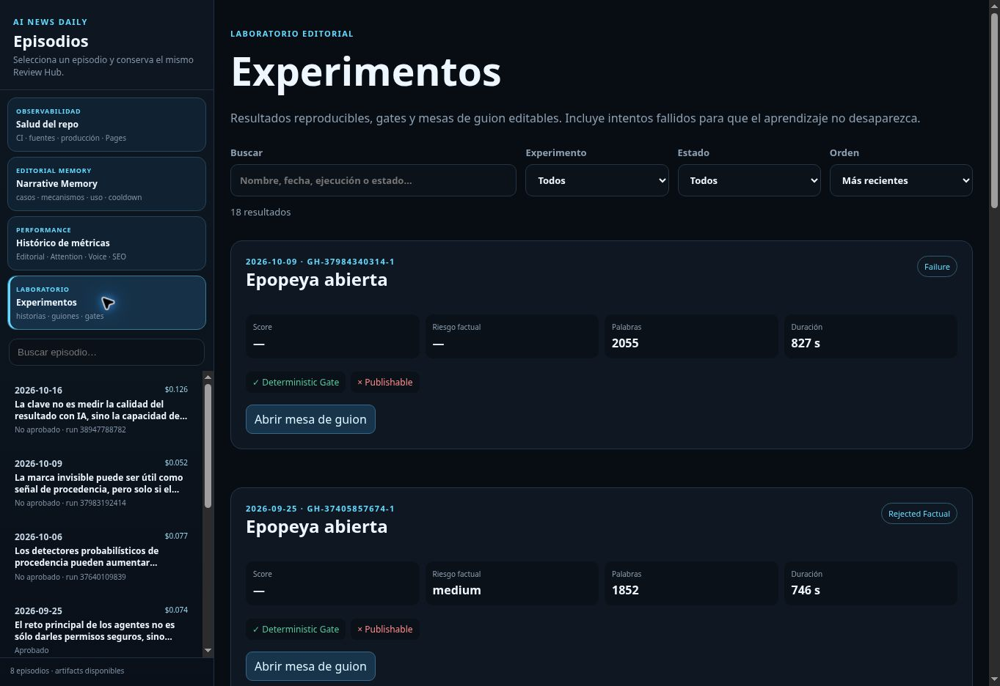

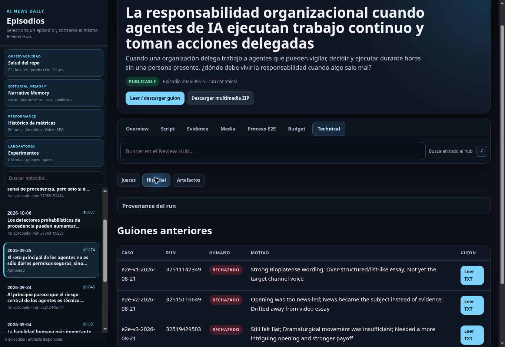
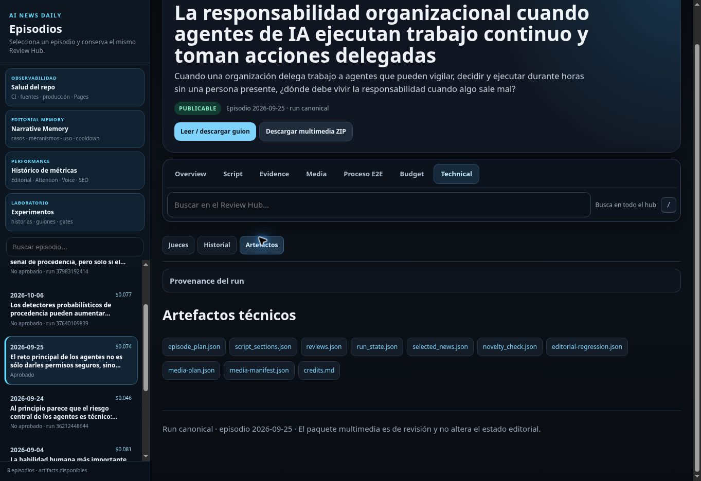

## Validación y límites

Validación determinista: **546 pruebas aprobadas**, compilación de `app`/`pipeline`, suite completa de unittest, sintaxis del JavaScript generado y construcción estática con el episodio canónico. Las pruebas adicionales comprueban preservación literal del guion/estado, actualización idempotente del histórico y escape de títulos en el catálogo.

Las capturas permiten evaluar jerarquía y densidad, no certificar WCAG. Quedan fuera una auditoría con lector de pantalla, pruebas con usuarios y verificación en un Android físico. La vista previa local no está disponible en el navegador de esta sesión; la comprobación visual se realiza sobre el despliegue público tras CI.

## Comprobación sobre Pages publicado

[Primer despliegue verificado](https://github.com/jcval94/AI-News-Daily/actions/runs/39100944672). La revisión visual detectó un conflicto de contraste heredado en “Editar” y que el reset de medios quedaba dentro del desplegable avanzado; ambos se corrigieron en la pasada final. El encabezado se compacta más al entrar a una tarea distinta de Resumen.

| Recorrido probado en navegador | Resultado observado |
|---|---|
| Navegar al Guion | La URL exterior conserva episodio y pestaña. |
| Lectura enfocada | Oculta el mapa y conserva literalmente el texto del guion. |
| Salud → Críticas → búsqueda sin coincidencias → Limpiar | 1/22 → estado vacío → 22/22. |
| Memoria → teclado → Noticias → búsqueda vacía → Limpiar | Pestaña/ARIA sincronizados y noticias recuperadas. |
| Métricas → desplegar producción | 8 columnas editoriales → 19 columnas completas; búsqueda vacía explícita. |
| Experimentos → búsqueda vacía → Restablecer | 0 → 18 resultados. |
| Abrir intento 2026-10-16 | Interfaz histórica actualizada y estado “No aprobado” conservado. |

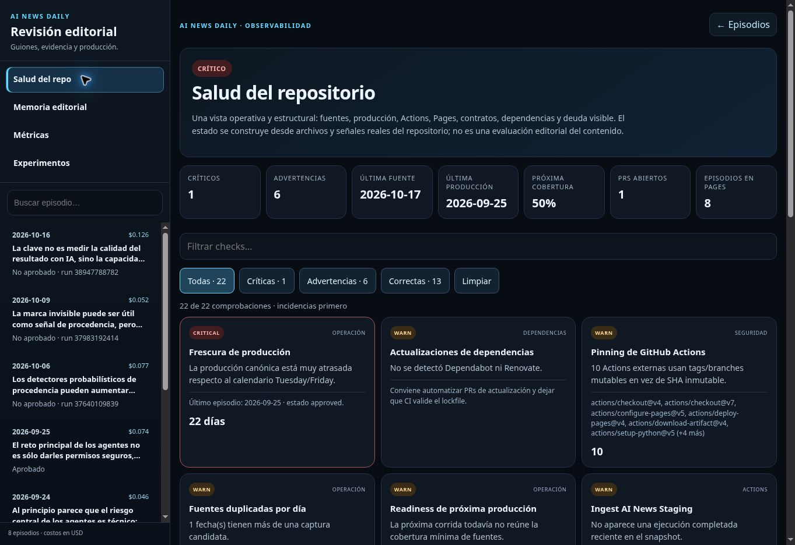

## Cierre de la verificación final

La versión UX v2 se comprobó en [Pages](https://github.com/jcval94/AI-News-Daily/actions/runs/39101615661): filtros locales + video sin coincidencias y reset visible recuperan los 53 recursos; proveedores tienen 44 px de alto; lectura enfocada oculta también el aviso de audio ausente sin modificar el guion. Proceso conserva las 36 etapas, con 14 filas observadas y 22 agrupadas. Los cinco beats muestran nombres narrativos legibles y conservan sus IDs.

Se detectó además caché antigua dentro del iframe: el servidor ya servía UX v2, mientras el catálogo podía reutilizar UX v1. La carga de episodios incorpora ahora la versión del despliegue. Una prueba del runtime real comprueba que la URL incluye esa versión y que seleccionar otra vez el mismo episodio no recarga el frame ni interrumpe el borrador.
